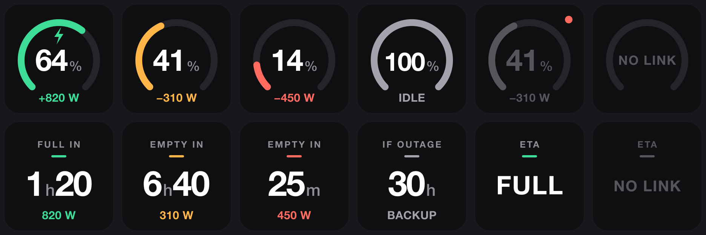

# Marstek Analytics

A Stream Deck plugin for the Marstek Venus E 3.0 home battery. It reads the battery over your LAN and shows two keys:

- **Battery level:** charge percent on a ring gauge and current power (`+` while charging).
- **ETA:** time until full while charging, time until empty while discharging. While idle on the grid it shows `IF OUTAGE`: how long the battery would carry the backup-socket load. With that socket idle it shows `—`.



Green means charging, amber discharging, red under 20 % or under 30 min. A red dot means the last poll failed and the key shows the last reading.

The plugin only reads and never sends a command that changes the battery. It sends only `ES.GetStatus`, every 15 s.

## Requirements

- Stream Deck 7.1 or later on macOS 12+ or Windows 10+
- Node 24
- Open API enabled for the battery in the Marstek app (UDP port 30000 by default)
- A fixed LAN address for the battery. The firmware ignores discovery, so you type the IP into the key settings.

## Install from source

```bash
cd streamdeck
npm install
npm run build
npx streamdeck link com.mlapin.marstek.sdPlugin
```

Restart Stream Deck, drag **Battery level** and **ETA** from the Marstek Battery category, and enter the battery IP in the key settings. The floor setting is the charge percent the battery keeps in reserve (12 % by default); the ETA counts down to it.

## Check the connection

```bash
cd streamdeck
MARSTEK_HOST=192.168.1.50 npm run probe
```

It prints a line every 15 s with the percent and watts. They should match the Marstek app.

## iPhone widgets

`ios/` holds Battery ETA, an iPhone app with three widgets: a charge ring, charge with ETA, and a Lock Screen gauge. The phone reads the battery directly, so the widgets update only on the battery's Wi‑Fi; elsewhere they show the last reading and `NO LINK`. iOS refreshes widgets about every 15–30 minutes, and the widget ETA is energy left ÷ current power.

```bash
cd ios
make test
make upload BUILD=2
```

Requires Xcode, `brew install xcodegen librsvg imagemagick`, and team `WSCTL2V8W5`. Raise `BUILD` for every upload.

## How the ETA works

Each ETA comes from the latest reading alone, with the same formula as the iPhone app. Time to full is the missing energy ÷ (charge power × 0.88). Time to empty is the energy above the floor ÷ 1.09 ÷ load. Power within 30 W of zero counts as idle, and every ETA stops at 240 h. The formula lives in `streamdeck/src/core/estimator.ts` and `ios/Shared/Estimate.swift`.

## Development

Run from `streamdeck/`: `npm test`, `npm run typecheck`, `npm run watch` (rebuilds and restarts the plugin on save).
